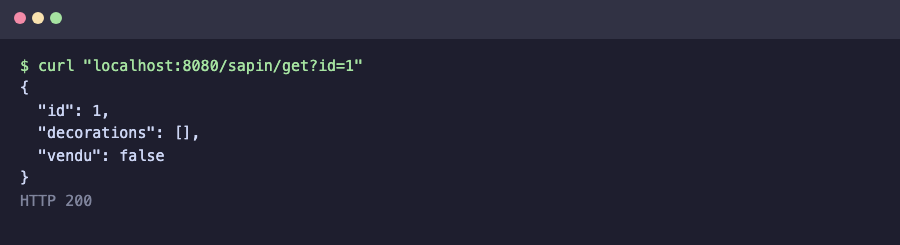
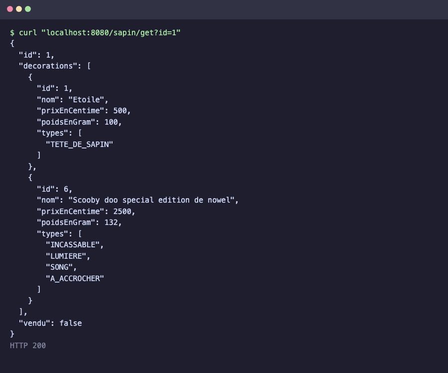
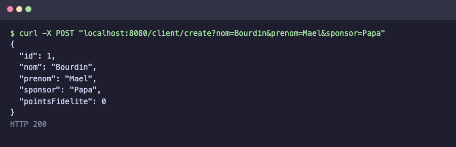
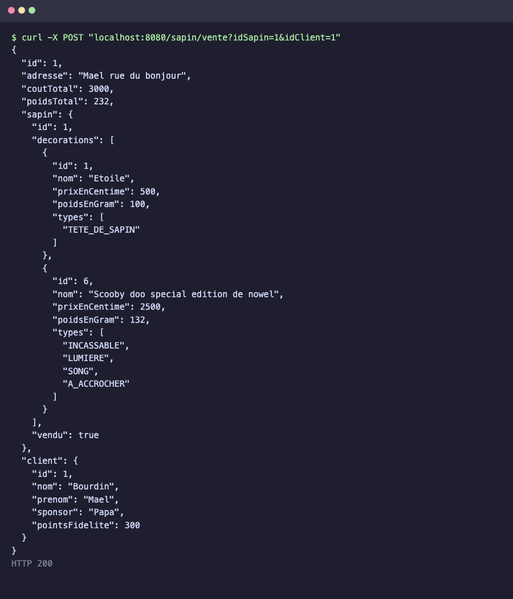
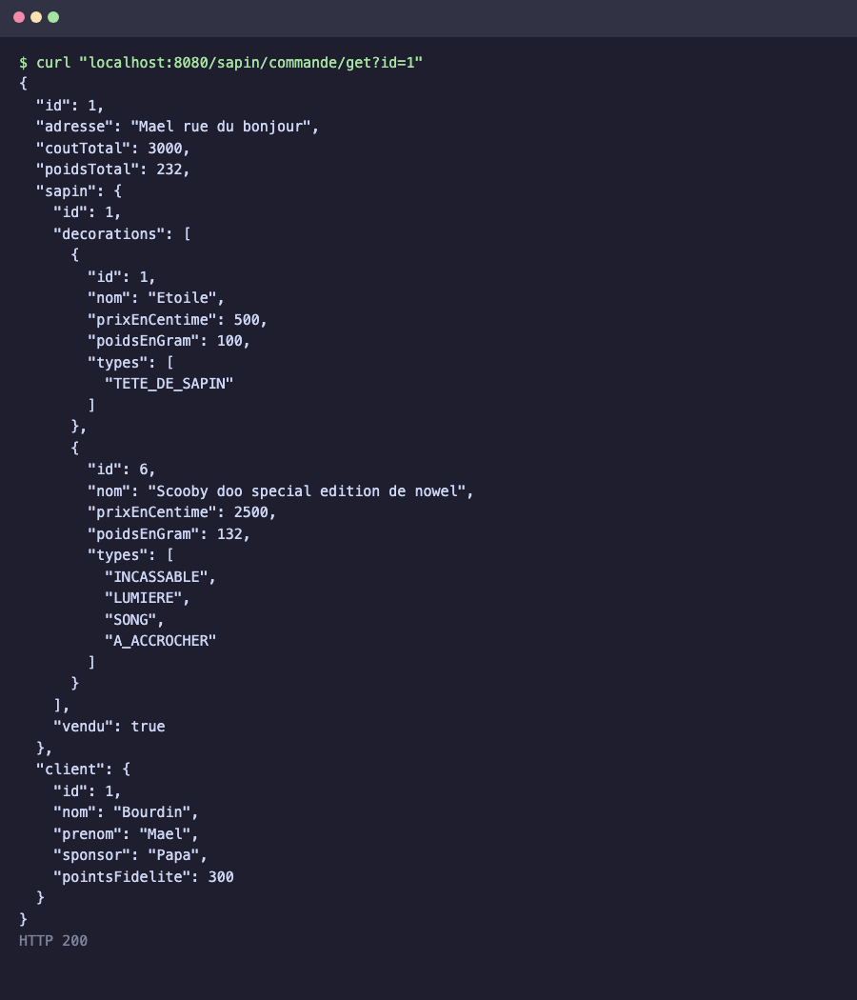

# Les sapins de nowel

Examen Spring débutant. API REST pour décorer des sapins et les vendre à des clients.

## Lancer le projet

Il faut Java 17, Maven et un MySQL qui tourne en local sur le port 3306.

```bash
mvn spring-boot:run
```

L'appli démarre sur le port 8080 avec le profil `dev`. La base `nowelle_dev` est créée toute seule et les tables se mettent à jour automatiquement. Au premier démarrage, 13 décorations sont ajoutées en base.

Le mot de passe de la base n'est pas dans la config. Par défaut l'utilisateur est `root` sans mot de passe. Sinon on le passe comme ça :

```bash
DB_USERNAME=root DB_PASSWORD=monmotdepasse mvn spring-boot:run
```

Pour repartir d'une base vide :

```bash
mysql -uroot -e "DROP DATABASE IF EXISTS nowelle_dev"
```

## Les routes

| Verbe | Route | Paramètres | Retour |
|---|---|---|---|
| GET | `sapin/get` | `id` | le sapin, ou null |
| POST | `sapin/create` | aucun | le nombre de sapins en base |
| POST | `sapin/addDecoration` | `idSapin`, `idDecoration` | true ou false |
| POST | `sapin/vente` | `idSapin`, `idClient` | le bon de commande, ou null |
| GET | `sapin/commande/get` | `id` | le bon de commande, ou null |
| GET | `client/get` | `id` | le client, ou null |
| POST | `client/create` | `nom`, `prenom`, `sponsor` | le client créé |

## Les tests

Les tests ont été faits dans cet ordre, sur une base vide. Une réponse vide veut dire que la route a renvoyé null.

### 1. Créer un sapin

```bash
curl -X POST localhost:8080/sapin/create
```

Renvoie 1 car c'est le premier sapin en base.


### 2. Récupérer le sapin

```bash
curl "localhost:8080/sapin/get?id=1"
```



### 3. Récupérer un sapin qui n'existe pas

```bash
curl "localhost:8080/sapin/get?id=999"
```

Pas de sapin avec cet id, donc null.


### 4. Ajouter l'Etoile au sapin

```bash
curl -X POST "localhost:8080/sapin/addDecoration?idSapin=1&idDecoration=1"
```


### 5. Ajouter le Scooby doo au sapin

```bash
curl -X POST "localhost:8080/sapin/addDecoration?idSapin=1&idDecoration=6"
```


### 6. Voir le sapin décoré

```bash
curl "localhost:8080/sapin/get?id=1"
```



### 7. Créer un client

```bash
curl -X POST "localhost:8080/client/create?nom=Bourdin&prenom=Mael&sponsor=Papa"
```



### 8. Vendre le sapin au client

```bash
curl -X POST "localhost:8080/sapin/vente?idSapin=1&idClient=1"
```

Le coût total fait 500 + 2500 = 3000 et le poids total 100 + 132 = 232. Le sapin passe en vendu et le client gagne 10 pourcent de 3000, soit 300 points.



### 9. Revendre le même sapin

```bash
curl -X POST "localhost:8080/sapin/vente?idSapin=1&idClient=1"
```

Le sapin est déjà vendu, donc null.


### 10. Ajouter une décoration après la vente

```bash
curl -X POST "localhost:8080/sapin/addDecoration?idSapin=1&idDecoration=2"
```

Le sapin est vendu, on ne peut plus le décorer, donc false.


### 11. Récupérer le bon de commande

```bash
curl "localhost:8080/sapin/commande/get?id=1"
```



### 12. Vérifier les points du client

```bash
curl "localhost:8080/client/get?id=1"
```

Le client a bien ses 300 points de fidélité.


